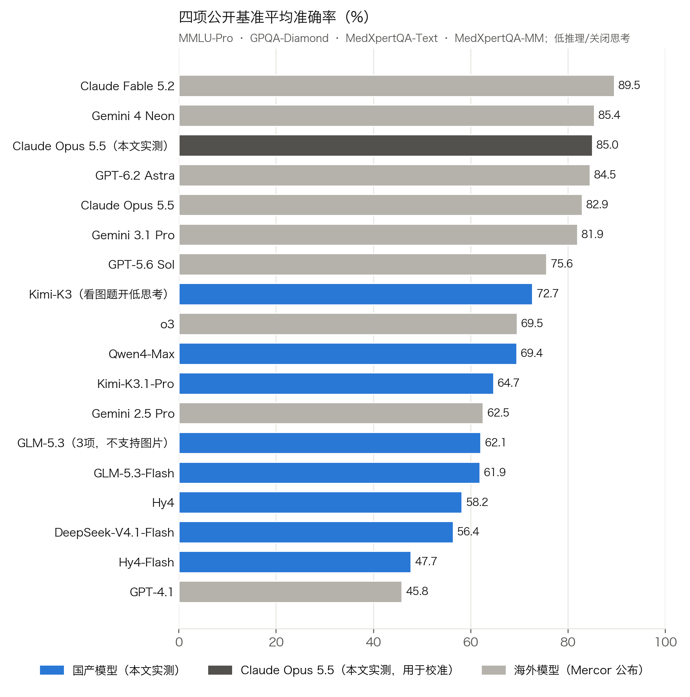
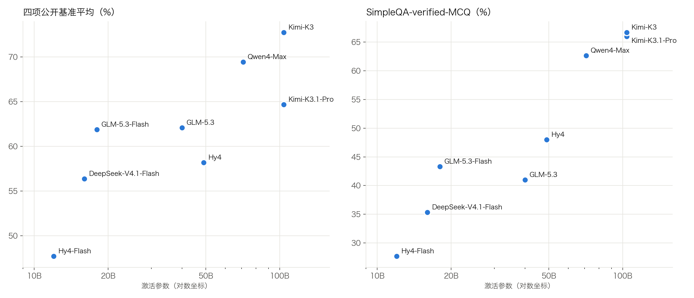
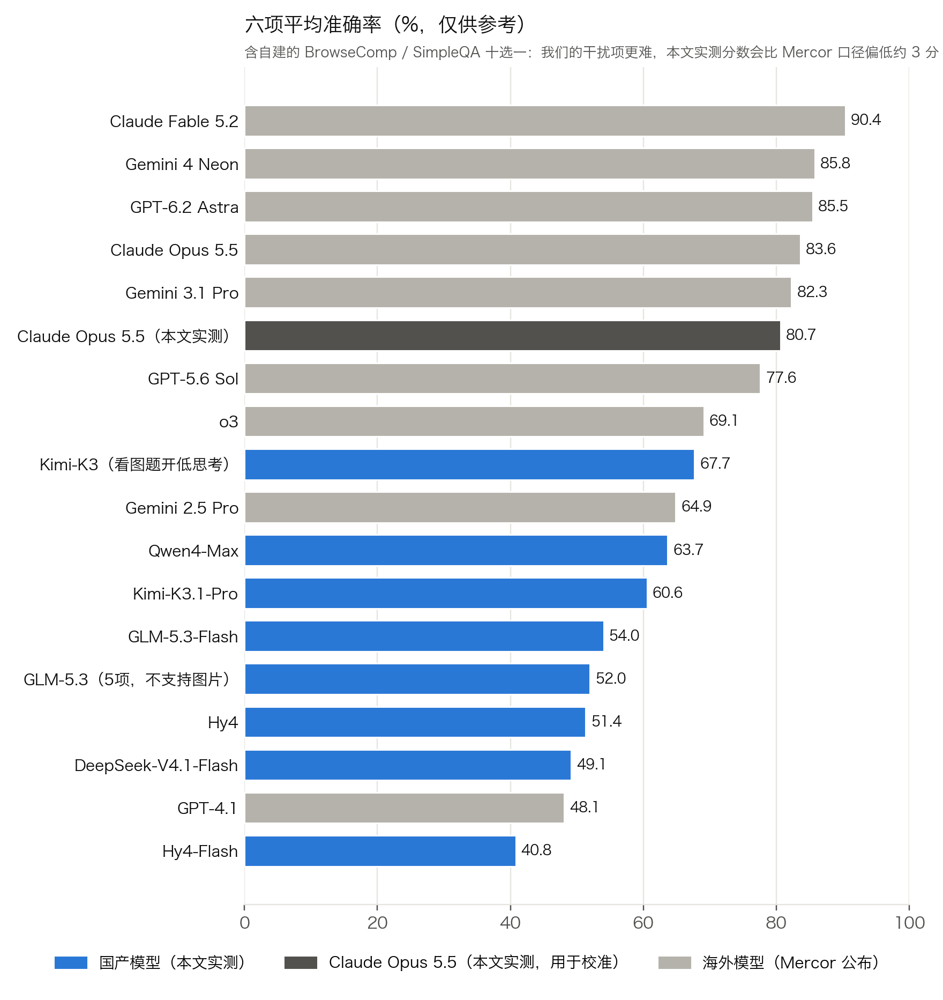

<div align="center">

# 🧠 关掉思考后，谁的底子最厚？

**用 Jason Wei 的困惑度代理指标，给国产大模型做一次"基座体检"**

[](#-六个基准)
[](#-测法)
[](#-结果)
[](requirements.txt)
[](#-快速开始)
[](LICENSE)



</div>

---

## 💡 这是什么

预训练 loss 衡量模型给正确的下一个 token 分了多少概率，最能反映基座的"天赋"。闭源 API 只返回文字、拿不到概率，loss 也就算不出来。

Jason Wei 在 Mercor 的博客 [[1]](https://www.mercor.com/blog/a-simple-proxy-for-perplexity/) 给了一个替代办法：

- 六个多选题基准，**关掉思考**，只让模型回一个字母；
- 取六项准确率的**简单平均**。

在 OpenAI 公布过 loss 的九个模型上，这个平均分和 log-perplexity 的 Spearman 相关是 **−0.98**。

我们用同一把尺子测了 8 个国产大模型，并复测了 Mercor 图上的 Claude Opus 5.5 做校准。本仓库公开：

| | 内容 |
|---|---|
| 🛠 `scripts/` | 数据下载构建、并发评测、汇总，接任意 OpenAI 兼容接口 |
| 🧩 `data/*_options.jsonl` | 自建的 BrowseComp / SimpleQA-verified 十选一干扰项（只有编号和选项，不含题干和答案） |
| 📊 `results.csv` | 全部模型的汇总成绩、token 和费用 |

> 逐题结果不公开。

## 📊 结果

准确率单位为 %。每个基准至多 300 题，GPQA-Diamond 全部 198 题。

| 模型 | MMLU-Pro | GPQA-D | MedX-Text | MedX-MM | BrowseComp | SimpleQA | **四项公开平均** | **六项平均** | 总参数 / 激活 | 费用 ¥ |
|---|---:|---:|---:|---:|---:|---:|---:|---:|---|---:|
| Claude Opus 5.5 *(校准)* | 92.0 | 90.9 | 68.0 | 89.0 | 61.7 | 82.3 | **85.0** | **80.7** | 未公开 | 86.36 |
| Kimi-K3 ¹ | 87.0 | 86.9 | 48.0 | 69.0 | 48.7 | 66.7 | **72.7** | **67.7** | 2.8T / 104B | 100.15 |
| Qwen4-Max | 84.7 | 71.7 | 55.7 | 65.7 | 41.7 | 62.7 | **69.4** | **63.7** | 2.4T / 71B | 7.52 |
| Kimi-K3.1-Pro | 83.7 | 64.6 | 44.7 | 65.7 | 38.7 | 66.0 | **64.7** | **60.6** | 2.8T / 104B | 15.81 |
| GLM-5.3-Flash | 81.7 | 66.2 | 36.7 | 63.0 | 33.3 | 43.3 | **61.9** | **54.0** | 320B / 18B | 1.19 |
| GLM-5.3 ² | 78.0 | 71.2 | 37.0 | — | 32.7 | 41.0 | **62.1** ³ | **52.0** ⁵ | 744B / 40B | 11.72 |
| Hy4 | 78.3 | 61.1 | 38.7 | 54.7 | 27.3 | 48.0 | **58.2** | **51.4** | 770B / 49B | 4.91 |
| DeepSeek-V4.1-Flash | 82.3 | 65.2 | 32.3 | 45.7 | 34.0 | 35.3 | **56.4** | **49.1** | 552B / 16B | 7.88 |
| Hy4-Flash | 67.7 | 51.5 | 30.0 | 41.7 | 26.3 | 27.7 | **47.7** | **40.8** | 220B / 12B | 0.33 |

<sub>¹ Kimi-K3 关闭思考时只允许温度 0.6；看图题必须开思考才能读图，MedX-MM 用 `reasoning_effort=low`。它关掉思考后仍常在字母后附长段解释，分数和其他模型不完全同一口径。<br>
² GLM-5.3 无法关闭思考，用最低的 `reasoning_effort=low`；不支持图片输入。<br>
³ 三项平均（不含看图题）。⁵ 五项平均（不含看图题）。<br>
费用按各家官方标价计算；Opus 按 $4 / $20 每百万 token、汇率 7.2 换算。</sub>

### 三个发现

**1. 参数越多，底子越厚。** 八个国产模型的激活参数和四项公开平均的秩相关是 0.89，和 SimpleQA 是 0.97。总参数 2T 以上的三个模型正好是前三名。

<div align="center"></div>

**2. 冷门事实拉开差距。** 自建的两份十选一题区分度更高：国产模型在 SimpleQA 上从 27.7 到 66.7，差 39 分；在三项公开文字题上只差 24 分。长尾事实要靠参数存，很难靠后训练补上。

**3. 同一个基座，表现可以差很多。** Kimi-K3 和 K3.1-Pro 大小、基座都相同，SimpleQA 几乎一样（66.7 对 66.0），GPQA 却差了 22 分。

### 和 Mercor 公布成绩的关系

| | 四项公开平均 | BrowseComp | SimpleQA | 六项平均 |
|---|---:|---:|---:|---:|
| Opus 5.5，本仓库 | 85.0 | 61.7 | 82.3 | 80.7 |
| Opus 5.5，Mercor 公布 | 82.9 | 79.8 | 90.4 | 83.6 |

- **四项公开平均**和 Mercor 对得上，可以直接对照。
- **BrowseComp 和 SimpleQA** 的十选一版本 Mercor 没有公开，这两项是我们自建的，干扰项更难。因此六项平均比 Mercor 口径低约 3 分，只适合在本仓库测的模型之间比较。

<details>
<summary>📈 六项平均和 Mercor 公布的海外模型放在一起（仅供参考）</summary>
<br>
<div align="center"></div>
</details>

## 🧪 六个基准

| 基准 | 题数 | 选项 | 考什么 |
|---|---:|---:|---|
| [MMLU-Pro](https://arxiv.org/abs/2406.01574) | 300 | ≤10 | 14 个学科的大学水平知识 |
| [GPQA-Diamond](https://arxiv.org/abs/2311.12022) | 198 | 4 | 博士级物理、化学、生物难题 |
| [MedXpertQA-Text](https://arxiv.org/abs/2501.18362) | 300 | 10 | 美国执业医师和专科考试 |
| [MedXpertQA-MM](https://arxiv.org/abs/2501.18362) | 300 | 5 | 看 X 光、CT、病理图做诊断 |
| [BrowseComp](https://arxiv.org/abs/2504.12516)-MCQ 🧩 | 300 | 10 | 层层设限的冷门事实 |
| [SimpleQA-verified](https://arxiv.org/abs/2509.07968)-MCQ 🧩 | 300 | 10 | 一句话能答的长尾事实 |

<sub>🧩 = 本仓库自建的十选一版本</sub>

## 🔬 测法

- **提示词**：系统提示为 `The following is a multiple choice question. Respond with only the letter of the correct answer, and nothing else.`，用户消息是题干、带字母的选项，最后一行 `Answer:`。
- **推理档位**：能关思考的一律关掉，关不掉的用最低档。每个模型的参数见 [`model_config.json`](model_config.json)。
- **采样**：能设温度的设为 0；输出上限 8192 token；固定种子 `20261125` 抽题。
- **判分**：答案依次取
  1. 整个回复只有一个字母；
  2. 回复开头的字母；
  3. 明确标注的答案，如 `\boxed{B}`、`Answer: B`、加粗的 **B**；
  4. 回复末尾单独的字母。

  都取不到算错；被截断、接口报错也算错。

## 🧩 自建十选一题集

每行一题，只有官方题目编号和十个选项：

```json
{"source_id": 10, "options": ["Humble Defender", "Benevolent Fighter", "..."]}
```

- **`source_id`**：BrowseComp 是 `smolagents/browse_comp` 测试集的行号，和 OpenAI 的 `browse_comp_test_set.csv` 顺序一致；SimpleQA-verified 是 `google/simpleqa-verified` 的 `original_index`。
- **为什么不含题干和答案**：BrowseComp 官方要求题目和答案不以明文出现在网上，以免进入训练语料。`prepare_data.py` 会下载官方数据、解密 BrowseComp，再用官方答案匹配十个选项，自动定出正确字母。
- **干扰项怎么来的**：
  - 由 GPT-6.2 Sol 生成，要求和正确答案同类型、同格式、同粒度，不能是别名或改写，也不能都围着正确答案做小改动。
  - 生成后过一遍"只看选项猜答案"：隐去题干，让三个不在被测名单里的模型只看十个选项猜答案。两个以上猜中，就重写这道题，最多三轮。
  - 过滤后，检查模型只看选项的猜中率降到 12%–16%，接近随机的 10%。

## 🚀 快速开始

```bash
git clone https://github.com/refraction-ray/perplexity-proxy.git && cd perplexity-proxy
pip install -r requirements.txt

# 1. 下载并构建六个题集（MedXpertQA 图片约 1GB）
python scripts/prepare_data.py
#    访问不了 huggingface.co 时：HF_ENDPOINT=https://hf-mirror.com python scripts/prepare_data.py

# 2. 评测：任意 OpenAI 兼容接口
export OPENAI_API_KEY=sk-...
python scripts/run_eval.py --base-url https://your-endpoint/v1 \
    --models Qwen4-Max Hy4 --workers 16

# 3. 汇总
python scripts/summarize.py
```

- **加新模型**：在 [`model_config.json`](model_config.json) 里按接口上的模型名加一项，写上关闭思考的参数。`extra_body` 合并进请求 JSON，`top_level` 作为普通参数传入。
- **断点续跑**：中途断了重跑同一条命令即可，会跳过已完成的题，只重试报错的题。
- **只测一部分**：`--benchmarks mmlu_pro gpqa_diamond` 指定基准，`--limit 20` 每项只跑前 20 题。

## 📁 目录

```
├── scripts/
│   ├── prepare_data.py     # 下载官方数据 → data/<benchmark>.jsonl
│   ├── run_eval.py         # 并发评测，可断点续跑
│   └── summarize.py        # 准确率、平均分、token、费用
├── data/
│   ├── browsecomp_mcq_options.jsonl
│   └── simpleqa_verified_mcq_options.jsonl
├── model_config.json       # 每个模型关闭思考的参数和官方单价
├── results.csv             # 汇总成绩
└── assets/                 # README 用图
```

## 📚 引用

本仓库的方法来自：

> J. Wei, *A simple proxy for perplexity*, Mercor Blog. https://www.mercor.com/blog/a-simple-proxy-for-perplexity/

使用各基准时请同时引用原始论文：
[MMLU-Pro](https://arxiv.org/abs/2406.01574) ·
[GPQA](https://arxiv.org/abs/2311.12022) ·
[MedXpertQA](https://arxiv.org/abs/2501.18362) ·
[BrowseComp](https://arxiv.org/abs/2504.12516) ·
[SimpleQA Verified](https://arxiv.org/abs/2509.07968)

## 📄 许可证

本仓库的代码和自建干扰项以 [MIT 许可证](LICENSE) 发布。各基准的原题和答案归原作者所有，请遵守其各自的许可条款。
